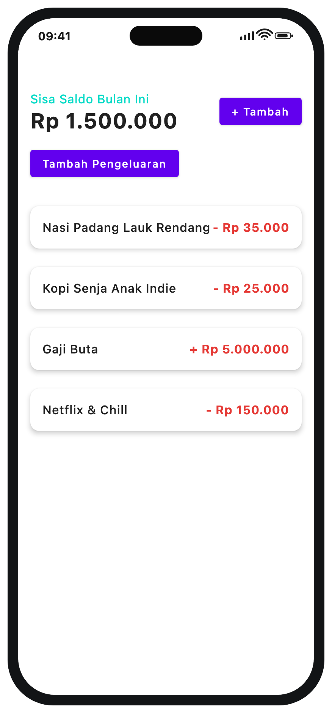
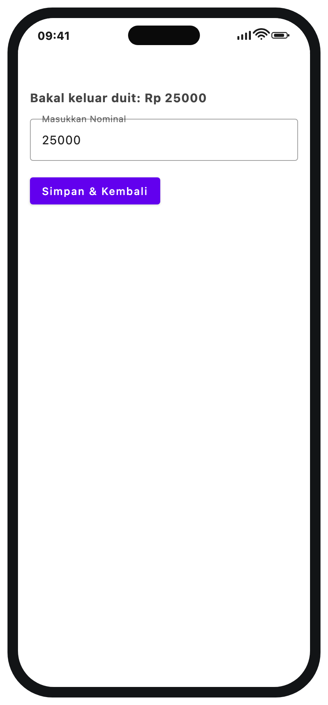
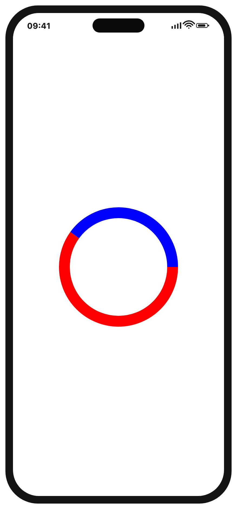
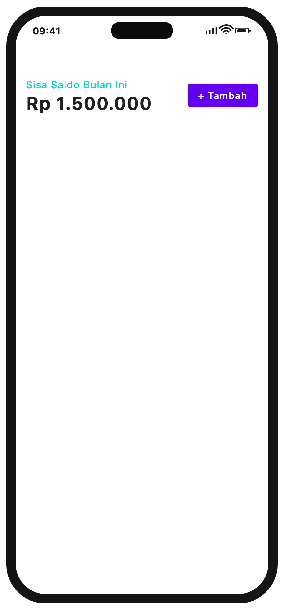
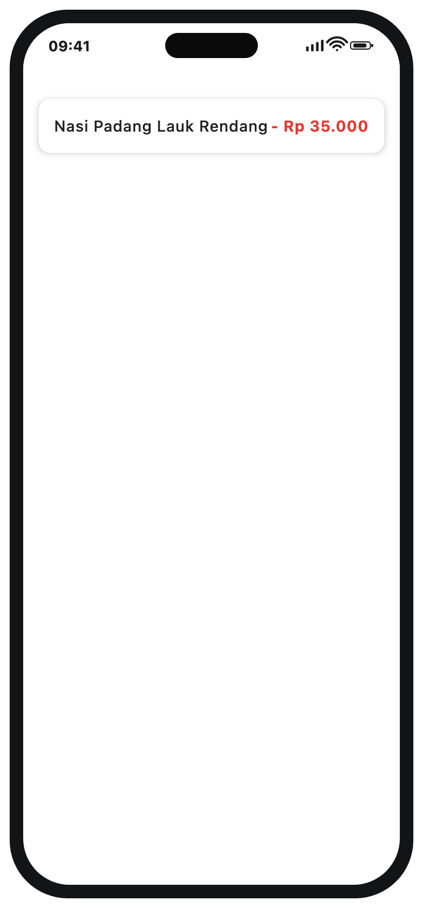
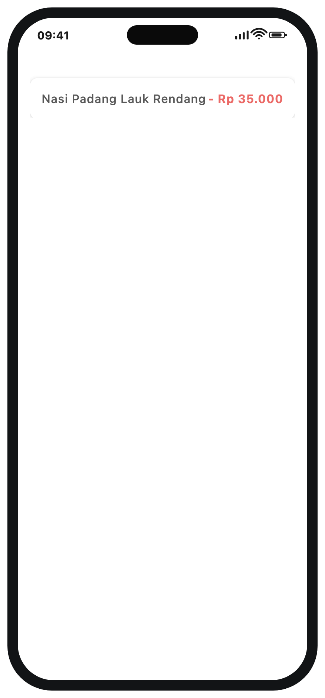
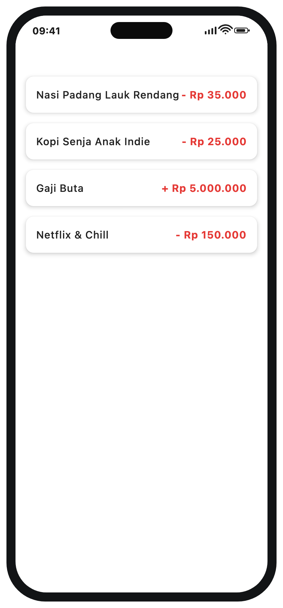

# Dompet — Compose Multiplatform

Repositori pendamping buku **Maha Kitab Sakti — Buku Pintar Compose Multiplatform**
oleh **Sigit Suryono, M. Kom.**

Aplikasi contoh *"Dompet Kembang Kempis"*: **satu basis kode Kotlin**, UI ditulis
dengan **Compose Multiplatform**, berjalan di **Android** dan **iOS** — plus
**Desktop (JVM)** untuk pratinjau cepat dan render tangkapan layar buku.

```bash
# Ambil salinan proyek
git clone https://github.com/sigitsuryono25/dompet-kmp.git
cd dompet-kmp
```

---

## Tangkapan layar

| Beranda | Tambah Transaksi | Statistik |
|---|:--:|:--:|
|  |  |  |

| Header Saldo | Kartu Transaksi | Animasi Kartu |
|---|:--:|:--:|
|  |  |  |

| Daftar Terfilter (Bab 15) |
|:--:|
|  |

---

## Struktur proyek

```
.
├── shared/                       # UI + logika bersama (Compose Multiplatform)
│   └── src/
│       ├── commonMain/kotlin/com/jetbrains/kmpapp/
│       │   ├── App.kt                  # titik masuk @Composable (semua platform)
│       │   ├── model/Transaksi.kt      # data dummy + TransaksiUIState (@Immutable)
│       │   └── ui/DompetApp.kt         # seluruh komponen yang dirakit di buku
│       └── iosMain/kotlin/com/jetbrains/kmpapp/
│           └── MainViewController.kt   # jembatan Compose -> UIViewController iOS
├── androidApp/                   # aplikasi Android (MainActivity)
├── iosApp/                       # aplikasi iOS (Xcode project)
├── desktopApp/                   # runner desktop + tugas Gradle `screenshots`
├── per-bab/                      # kode tiap bab, disalin apa adanya dari buku
├── screenshots/                  # 7 tangkapan layar yang dipakai di buku
└── gradle/libs.versions.toml     # katalog versi & dependensi
```

> Kode yang dipakai di dalam buku **persis** sama dengan yang ada di
> `shared/src/commonMain/...`. Bab demi bab menumpuk berkas-berkas ini.

---

## Versi & dependensi

| Komponen | Versi |
|---|---|
| Kotlin | `2.4.10` |
| Compose Multiplatform | `1.11.1` |
| Compose Material (M2) | `1.11.1` |
| Android Gradle Plugin (AGP) | `9.1.1` |
| Gradle | `9.6.1` |
| Android compileSdk / minSdk / targetSdk | `37` / `24` / `37` |
| JVM target | `11` |

Dependensi yang dipakai aplikasi contoh ini:

```kotlin
commonMain.dependencies {
    implementation(compose.runtime)
    implementation(compose.foundation)
    implementation(compose.animation)
    implementation(compose.material)   // Material 2 (default MaterialTheme)
    implementation(compose.ui)
}
```

Bab di buku juga membahas pustaka lain (belum dirangkai di contoh ini, disertakan
versinya agar sinkron bila kelak ditambahkan):

| Pustaka | Versi | Dibahas di |
|---|---|---|
| Ktor Client | `3.5.1` | Bab 11 |
| Koin | `4.2.2` | Bab 12 |
| Room (AndroidX) | — | Bab 10 |
| Coil | `3.5.0` | — |
| Navigation Compose | `2.9.2` | Bab 6 |
| kotlinx-coroutines | `1.11.0` | Bab 8 |

---

## Menjalankan proyek

Prasyarat: **JDK 17+** (disarankan JDK 21) dan Android Studio / Xcode.

### Android

```bash
# Bangun APK debug
./gradlew :androidApp:assembleDebug

# Pasang ke perangkat/emulator yang terhubung
./gradlew :androidApp:installDebug
```

Atau buka folder ini di **Android Studio**, pilih konfigurasi `androidApp`, lalu ▶ Run.

### iOS

```bash
# Buka proyek di Xcode
open iosApp/iosApp.xcodeproj
```

Pilih sebuah simulator (mis. *iPhone 15 Pro*), lalu ▶ Run. Framework `Shared`
dibangun otomatis oleh Gradle lewat *Run Script* Xcode.

Butuh macOS + Xcode. Untuk target simulator Apple Silicon, `iosSimulatorArm64`
sudah dikonfigurasi di `shared/build.gradle.kts`.

### Desktop (JVM)

```bash
./gradlew :desktopApp:run
```

### Render ulang tangkapan layar (dipakai buku)

```bash
./gradlew :desktopApp:screenshots
# hasil -> screenshots/*.png
```

---

## Kode per bab

Seluruh potongan kode dari buku dikumpulkan di folder **[`per-bab/`](./per-bab/)**,
satu folder per bab — lihat **[`per-bab/README.md`](./per-bab/README.md)** untuk daftar lengkapnya.

| Bab | Topik | Folder |
|----:|-------|--------|
| 1 | Filosofi dan Persiapan Senjata | [`per-bab/bab-01-...`](./per-bab/bab-01-filosofi-dan-persiapan-senjata/) |
| 2 | Seni Menyusun Balok | [`per-bab/bab-02-...`](./per-bab/bab-02-seni-menyusun-balok/) |
| 3 | Sihir Kosmetik Bernama Modifier | [`per-bab/bab-03-...`](./per-bab/bab-03-sihir-kosmetik-bernama-modifier/) |
| 4 | Denyut Nadi Aplikasi (State) | [`per-bab/bab-04-...`](./per-bab/bab-04-denyut-nadi-aplikasi-state/) |
| 5 | Sungai Data yang Mengalir | [`per-bab/bab-05-...`](./per-bab/bab-05-sungai-data-yang-mengalir-lazycolumn/) |
| 6 | Pintu ke Mana Saja (Navigasi) | [`per-bab/bab-06-...`](./per-bab/bab-06-pintu-ke-mana-saja-navigasi-kmp/) |
| 7 | Otak di Balik Otot (State Hoisting) | [`per-bab/bab-07-...`](./per-bab/bab-07-otak-di-balik-otot-state-hoisting/) |
| 8 | Sihir Tak Kasat Mata (Side Effects) | [`per-bab/bab-08-...`](./per-bab/bab-08-sihir-tak-kasat-mata-side-effects/) |
| 9 | Tarian Layar yang Menggoda (Animasi) | [`per-bab/bab-09-...`](./per-bab/bab-09-tarian-layar-yang-menggoda-animasi/) |
| 10 | Mengukir Ingatan pada Besi (Database) | [`per-bab/bab-10-...`](./per-bab/bab-10-mengukir-ingatan-pada-besi-database-kmp/) |
| 11 | Berteriak ke Dunia Luar (Ktor) | [`per-bab/bab-11-...`](./per-bab/bab-11-berteriak-ke-dunia-luar-ktor-networking/) |
| 12 | Jarum Suntik Tanpa Rasa Sakit (Koin) | [`per-bab/bab-12-...`](./per-bab/bab-12-jarum-suntik-tanpa-rasa-sakit-koin-di/) |
| 13 | Menembus Dinding Kaca (Native) | [`per-bab/bab-13-...`](./per-bab/bab-13-menembus-dinding-kaca-native-interoperabilit/) |
| 14 | Melukis di Atas Kanvas Kosong (Skia) | [`per-bab/bab-14-...`](./per-bab/bab-14-melukis-di-atas-kanvas-kosong-skia-drawing/) |
| 15 | Mengusir Setan *Jank* (Performa) | [`per-bab/bab-15-...`](./per-bab/bab-15-mengusir-setan-jank-performance-optimization/) |

---

## Referensi

- Compose Multiplatform — https://www.jetbrains.com/help/kotlin-multiplatform-dev/compose-multiplatform.html
- Kotlin Multiplatform — https://kotlinlang.org/docs/multiplatform.html
- Jetpack Compose — https://developer.android.com/jetpack/compose
- Panduan Coroutines — https://kotlinlang.org/docs/coroutines-guide.html
- Ktor — https://ktor.io/docs/
- Koin — https://insert-koin.io/docs/
- Room — https://developer.android.com/training/data-storage/room
- Coil — https://coil-kt.github.io/coil/
- Material Design 2 — https://m2.material.io/
- Skia — https://skia.org/
- Template resmi KMP — https://github.com/Kotlin/KMP-App-Template

---

## Lisensi

Apache License 2.0 — lihat [LICENSE](./LICENSE).
